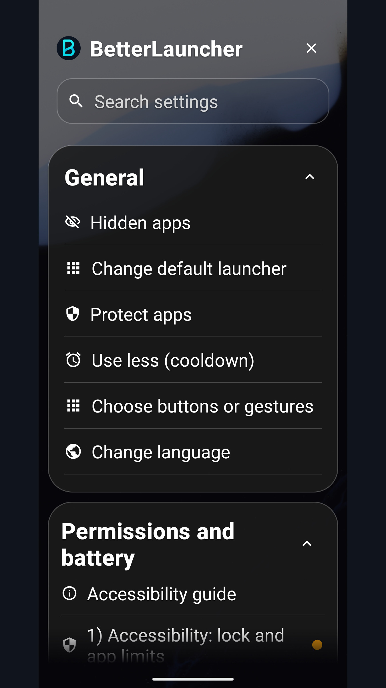
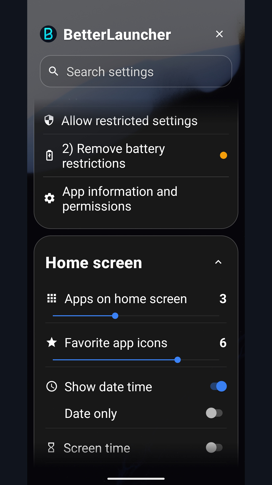
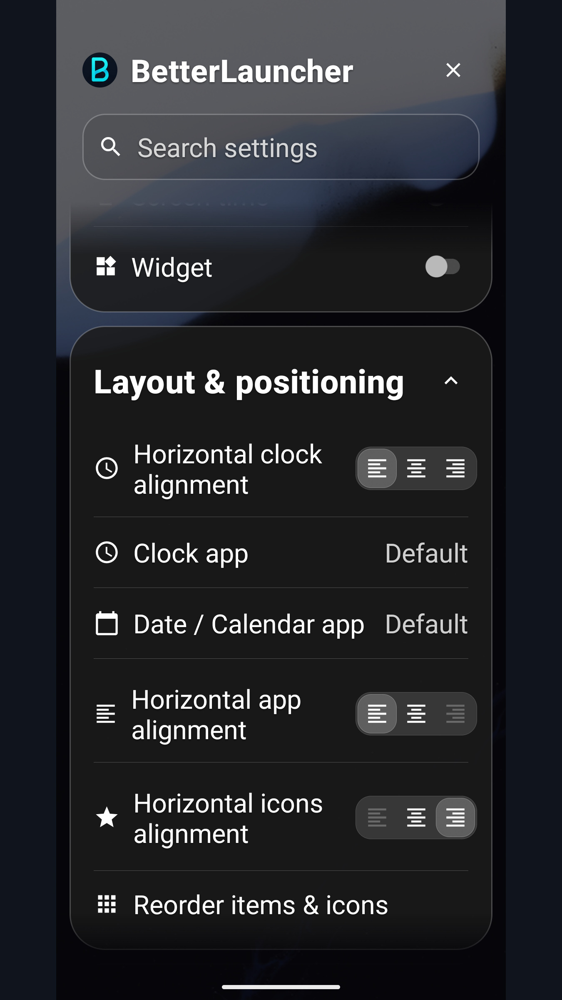
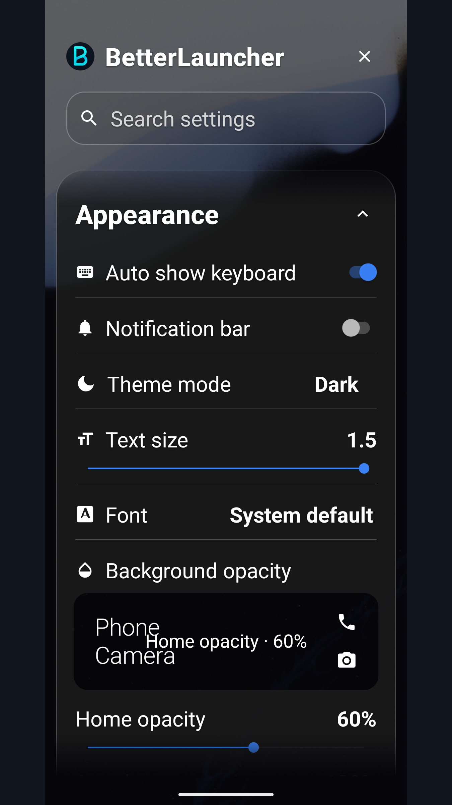
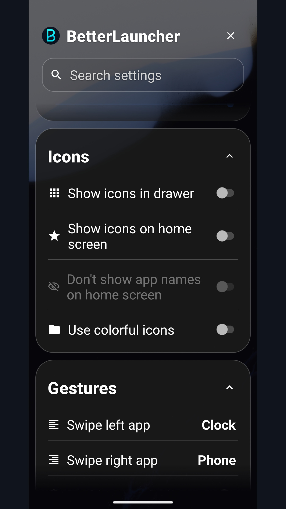
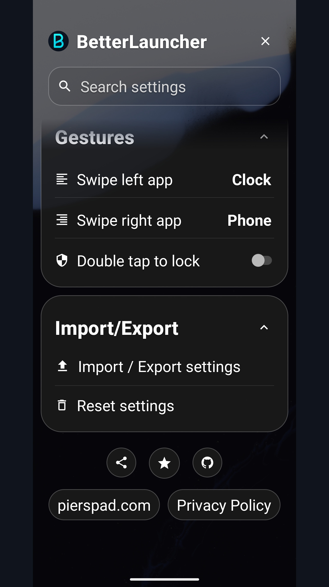

#  BetterLauncher

[](https://github.com/pierspad/BetterLauncher/releases/latest)
[](https://github.com/pierspad/BetterLauncher/actions/workflows/release.yml)
[](LICENSE)
[](https://github.com/pierspad/BetterLauncher/releases/latest)

[](https://github.com/sponsors/pierspad) [](https://buymeacoffee.com/pierspad) [](https://ko-fi.com/pierspad)

[Features](#features) · [Screenshots](#screenshots) · [Install](#install) · [Search](#search) · [Gestures](#gestures-and-accessibility) · [Development](#development) · [Contributing](CONTRIBUTING.md)

An Android launcher based on [Olauncher](https://github.com/tanujnotes/olauncher), with customizable shortcuts, widgets, folders and optional tools to reduce distracting app use. Free software, without ads or premium reminders.

## Features

- Text-based home screen with adjustable font, size, alignment and background opacity.
- Up to eight home apps and eight customizable shortcut icons; drag to reorder.
- A home-screen widget, app folders, hidden apps and optional monochrome Lawnicons.
- App opening protected by device credentials or biometrics within the launcher.
- Optional app limits with progressive cooldowns.
- App search with three matching modes; optional contact and Android settings search.
- Custom TrueType/OpenType fonts and an app language independent of the system.
- Settings import/export through JSON files or clipboard.
- Optional double tap to lock the screen.

## Screenshots

Click a preview to see the full image.

| General settings | Home screen options | Layout and alignment |
| :---: | :---: | :---: |
| <a href="fastlane/metadata/android/en-US/images/phoneScreenshots/01.jpg"></a> | <a href="fastlane/metadata/android/en-US/images/phoneScreenshots/02.jpg"></a> | <a href="fastlane/metadata/android/en-US/images/phoneScreenshots/03.jpg"></a> |

| Theme and opacity | Icons and gestures | Gestures and backups |
| :---: | :---: | :---: |
| <a href="fastlane/metadata/android/en-US/images/phoneScreenshots/04.jpg"></a> | <a href="fastlane/metadata/android/en-US/images/phoneScreenshots/05.jpg"></a> | <a href="fastlane/metadata/android/en-US/images/phoneScreenshots/06.jpg"></a> |

## Install

Download `betterlauncher-release.apk` from the [latest GitHub release](https://github.com/pierspad/BetterLauncher/releases/latest). Updates must use the same signing key as your existing installation.

BetterLauncher is also available on [F-Droid](https://f-droid.org/packages/com.pierspad.betterlauncher/) and [Google Play](https://play.google.com/store/apps/details?id=com.pierspad.betterlauncher). See [how F-Droid updates work](docs/f-droid.md).

## Settings backups

Export or import a JSON file from Settings → Import / Export settings. Invalid
values are rejected before replacing the saved configuration. Backups can include
a custom font, but Android permissions and widget bindings must be configured
again on the destination device. Keep exported files private: they contain your
launcher configuration, including app choices and aliases.

## Search

| Mode | Behavior | Example |
| :--- | :--- | :--- |
| Precise (default) | Consecutive fragments inside separate words, in order | `edd` → Reddit; `ton ail` → Proton Mail |
| Flexible | Query characters may occur anywhere, in order | `rdd` → Reddit |

A unique matching app opens automatically. Multiple matches remain available for
selection. Updating to 1.5.3 selects Precise once, including existing installations;
you can choose Flexible afterward. Contact search is optional and requires contact
permission. Ordinary app search works without it.

## Gestures and accessibility

Enable **Double tap to lock** in Settings → Gestures and enable BetterLauncher in Android Accessibility settings. The in-app notice includes troubleshooting help.

The optional accessibility service also enforces configured app cooldowns. A separate disclosure explains its access before activation. Accessibility data is processed on the device. You can decline or disable the service and keep using ordinary launcher features.

App lock protects launches through BetterLauncher; it does not prevent another application or Android itself from opening the target app.

## Development

Use JDK 17, Android SDK 36 and the included Gradle wrapper:

```sh
./gradlew assembleDebug assembleDebugAndroidTest lintDebug
```

The debug app has a separate `.debug` package. See [CONTRIBUTING.md](CONTRIBUTING.md) for emulator regression checks and the release workflow. Google Play release automation is described in [docs/google-play-release.md](docs/google-play-release.md).

## Contributing

Bug reports, translations and focused pull requests are welcome. Please discuss substantial changes in an issue first. See [CONTRIBUTING.md](CONTRIBUTING.md).

## Acknowledgements

Based on [Olauncher](https://github.com/tanujnotes/olauncher), with monochrome icons from [Lawnicons](https://github.com/LawnchairLauncher/lawnicons). Their respective licenses and attribution remain in the source.

## AI disclosure

Development and documentation have been assisted by language models. Contributions still require review and verification.

## License

[GNU GPL v3](LICENSE).
